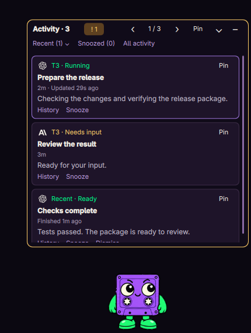

# Spool for Omarchy



Spool is a violet cassette companion for your Linux desktop. It follows local T3 Code sessions and can also follow Codex desktop and ChatGPT activity through the Codex desktop app. Its activity cards show progress, threads needing attention, and recent completions.

## Requirements

- Omarchy with the Quickshell plugin API, Quickshell 0.3.1 or compatible, and Hyprland.
- Python 3.11 or later; no third-party Python runtime dependencies.
- T3 Code for T3 activity, or a running Codex desktop app with its local task-tool endpoint for desktop activity.

Developed on Omarchy with Hyprland 0.56.2. Both activity sources are compatibility adapters to local app interfaces; app updates may require adapter changes. The desktop adapter is experimental and currently has an unresolved live endpoint timeout on the development host. T3 activity works independently.

## Install or update

Extract the release archive and run:

```sh
./install.sh
```

The installer backs up the existing plugin and `shell.json`, installs into `~/.config/omarchy/plugins/onnwee.spool`, and enables the service through Omarchy. It preserves existing preferences, including disabled activity tracking. If `CODEX_THREAD_ID` is present, it records that thread as the desktop adapter context. T3 tracking does not require running the installer from a Codex chat.

The pet starts with the existing Omarchy shell; no extra autostart entry is needed. Content-versioned QML and JavaScript imports prevent loading older plugin code. If the shell still retains a previous component, use `./install.sh --restart-shell`. That restarts the Omarchy shell and its plugins.

Backups are kept under `~/.local/state/spool/install-*`. To roll back, disable Spool, restore the plugin files from the chosen backup, rescan plugins, and re-enable it. Restore the backed-up `shell.json` only if you also intend to restore all shell settings from that point.

## Pet controls

- **Left-click:** bring the selected thread's app forward. With no selected activity, jump. Hold and drag to move the pet.
- **Middle-click:** wave.
- **Right-click:** open the menu for size, eyes, wandering, monitor, activity source, quiet controls, mini mode, and visibility.

The pet starts at the bottom right and hides on fullscreen workspaces by default. Only the sprite, activity bubble, and open menu accept pointer input. The transparent overlay reserves no screen space and requests no keyboard focus. Wandering is off by default.

Preferences live in Spool's entry in `~/.config/omarchy/shell.json`, with a recovery copy in `~/.local/state/spool/preferences.json`. This copy restores preferences after disabling and re-enabling the service.

## Activity views

The **full tray** is a scrollable stack. The newest progress comment brings its thread first. **Pin** keeps a chosen thread first across updates; **Unpin** restores recency ordering. Pins survive shell restarts and remain dormant while their thread has no activity.

The chevron switches between the full tray and a **single-card view**. Arrows cycle threads; scrolling over a compact card's title also cycles them. Each progress viewport shows at most five lines, with up to 6,000 characters available by scrolling over its text. Scroll over titles or status lines to move through the expanded tray.

**Mini mode** is a single 38-pixel-high line with the provider logo, status, count, and thread title. Use **−** in the tray header or **Mini mode** in the right-click menu to enter it. Its **⌃** button opens the full tray. Scrolling cycles threads; clicking the text brings the selected app forward. Mini mode survives restarts.

The amber **!** count indicates unsnoozed threads needing input or blocked by failure. Click it to select one. It stays visible even when another thread is pinned. The pet animation reflects input requests first, then failure, unread completions, and running tasks; card order follows progress recency.

Cards show elapsed run time and last-update age. Hover over a provider logo or timing line for app, provider, and model details when available. If the desktop source supplies no start time, elapsed time starts when Spool observes the run. Known providers have logos; custom providers fall back to their initial.

## History, completions, and quiet controls

- **History:** the last five observed progress comments from the current run, oldest first. Streaming extensions update the same comment. Entries show up to 2,000 characters each in the five-line viewport. **Latest** returns to the current update. New runs clear the thread's history. Comments arriving entirely between polls can be missed.
- **Recent:** the five most recent observed completions, including visited T3 sessions, with finish ages and assistant previews. **Dismiss** hides one completion; a later completion from that thread can appear again. Sources repopulate this in-memory list after restart.
- **Snooze:** hide a thread for **15m**, **1h**, or **Until next run**. Snoozed threads are excluded from the attention count. **Snoozed** reveals hidden cards with **Resume** actions; **Resume all** also clears snoozes for absent threads. Next-run snoozes depend on a source run ID or an observed transition into a new run.
- **Pet motion:** pause movement and animation while keeping activity cards and timing updates active.
- **Needs attention:** filter the tray to requests for input and failures.

Pins, snoozes, dismissed completion identities, and view preferences are saved. Progress text, histories, titles, and completion previews remain in memory and are not saved in preferences.

## Sources and limits

**T3 Code** is the default source. The bridge reads `~/.t3/userdata/statev2.sqlite` in read-only transactions and checks the PID recorded in `server-runtime.json`. It follows the latest run of visible top-level sessions across providers. Queued and starting runs count as working. Archived, deleted, cancelled, and child subagent sessions are excluded.

T3 progress comes from assistant updates and recognized Codex public reasoning summaries. Raw reasoning, prompts, and command outputs are excluded. Unknown reasoning formats are skipped. Clicking a T3 card brings the existing desktop window forward and leaves its current thread selected. Exact thread navigation and browser pairing are not used; a closed T3 window is not relaunched.

**Desktop chats** follows Codex tasks and ChatGPT chats exposed by the Codex desktop app. It reads the 50 recent chats plus pinned chats, then at most eight detailed records per poll, prioritizing active and unread tasks. It uses only assistant updates, public reasoning summaries, and bounded completion previews. Native ChatGPT thinking captions are not always available. Clicking opens the selected desktop conversation through its local tool endpoint.

**Both** combines the sources. A failed source clears its active cards while the other continues. Recent completions remain until displaced or dismissed. Polls normally run every five seconds; desktop work has an eight-second sample budget. A slow detail read preserves an already-fetched status list. A 45-second watchdog clears stale active status.

Standalone CLI/IDE sessions, ChatGPT browser tabs, and remote T3 environments are not connected. The bridge sends no messages and approves no actions. There is no separate daemon or browser extension; it runs under the enabled plugin and stops when the plugin is disabled.

## Commands

```sh
omarchy-shell spool status
omarchy-shell spool show
omarchy-shell spool hide
omarchy-shell spool toggle
omarchy-shell spool menu
omarchy-shell spool mini
omarchy-shell spool activityTray
omarchy-shell spool cycleTask 1
omarchy-shell spool pinTask
omarchy-shell spool history
omarchy-shell spool snooze 15m
omarchy-shell spool snooze next
omarchy-shell spool resumeSnoozed
omarchy-shell spool dismissRecent
omarchy-shell spool animate waving
omarchy-shell spool configure '{"activitySource":"all"}'
omarchy-shell spool configure '{"pausePet":true,"onlyAttention":true}'
omarchy-shell spool configure '{"miniMode":true,"size":128,"right":24,"bottom":24}'
omarchy-shell spool configure '{"autoActivity":false}'
```

Activity sources are `t3`, `desktop`, and `all`. Menu size cycles between 64 and 192 pixels; IPC accepts 64 to 256. `status` includes thread IDs, titles, and progress text, so treat its output as conversation data.

Disable with `omarchy plugin disable onnwee.spool`; re-enable with `omarchy plugin enable onnwee.spool`. To remove, disable first, then remove only `~/.config/omarchy/plugins/onnwee.spool`. Backups and preferences are retained separately.

## Development and releases

```sh
make check
make dist
```

Checks require Node.js, `qmllint`, and ShellCheck in addition to Python. Ruff checks run when a working Ruff installation is available. The tests cover adapters, framed transport, task ordering, history, snoozes, and installation in isolated XDG directories. `make dist` builds an allowlisted, reproducible archive and SHA-256 checksum under `dist/`.

`Service.qml` owns the UI and lifecycle. `TaskQueue.js` owns ordering and selection. `ActivityStore.js` owns bounded history, recent completions, snoozes, and run normalization. `bridge.py` owns both local activity adapters. `install.sh` installs versioned components and retains backups.

For a standalone preview, disable the installed plugin and run `quickshell -p .`; stop the preview before re-enabling the service. `shell.qml` uses `ShellRoot` so the preview creates no blank floating window. Release checks and remaining qualification limits are in [docs/RELEASE.md](docs/RELEASE.md).

## License and artwork

Code and original Spool artwork are licensed under **AGPL-3.0-only**; see [LICENSE](LICENSE). Bundled provider icons retain their MIT license; see [NOTICE.md](NOTICE.md) and `assets/providers/LICENSE`.

The original transparent sprite atlas is 1536 × 2288, with 192 × 208 cells, eight columns, and eleven rows. Its SHA-256 is `500473e396cebfbbe7481b7f63026872149b9dc0e0e0bb89e000d3758b5cb6ee`.
