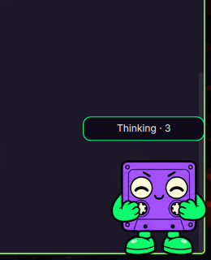

# Spool for Omarchy



Spool is a violet cassette companion with acid-green limbs, animated eyes, and a small desktop control menu. This Quickshell service plugin uses the original Subcult pet artwork.

Requires Omarchy with the Quickshell plugin API, Quickshell 0.3.1 or compatible, and Hyprland. Developed and run on Omarchy with Hyprland 0.56.2.

## Install

Run `./install.sh` from this directory in a Codex chat terminal. It copies the plugin into `~/.config/omarchy/plugins/onnwee.spool`, rescans plugins, and enables it. When run from Codex, the installer records that chat as the local adapter context and enables automatic activity tracking. Existing Spool files are backed up first. The script also backs up `shell.json`; settings are changed through Omarchy's plugin API.

If an update leaves the old code loaded or reports `Spool activity configuration failed`, run `./install.sh --restart-shell`. This restarts only the Omarchy shell through its existing launcher. Quickshell can retain plugin components after a registry rescan; the installer uses a component filename derived from the code hash so the updated service has a distinct identity.

The enabled service starts with the existing Omarchy shell. No additional Hyprland autostart entry is needed.

## Controls

- Left-click Spool to jump; hold and drag to move him.
- Middle-click to wave.
- Right-click to open or close the menu.
- The menu controls size, pointer-following eyes, wandering, reduced motion, monitor selection, automatic chat activity, and visibility.
- Size cycles from 64 to 192 pixels in the menu; IPC accepts 64 to 256 pixels.

Spool starts in the bottom-right corner. Only his rectangular sprite area and open menu accept pointer input. The layer never requests keyboard focus or reserves screen space. Fullscreen workspaces hide him by default. Wandering is off by default.

Settings are stored on Spool's entry in `~/.config/omarchy/shell.json`, with a local recovery copy in `~/.local/state/spool/preferences.json`. Omarchy removes a service entry when disabling it; the recovery copy restores Spool's preferences when he is re-enabled. Pointer tracking queries `hyprctl -j cursorpos` at most four times per second while Spool is visible, idle, and tracking is enabled. Hidden, reduced-motion, menu, and dragging states pause polling.

## Commands and integrations

```sh
omarchy-shell spool status
omarchy-shell spool show
omarchy-shell spool hide
omarchy-shell spool toggle
omarchy-shell spool menu
omarchy-shell spool animate waving
omarchy-shell spool animate jumping
omarchy-shell spool animate running
omarchy-shell spool animate waiting
omarchy-shell spool animate review
omarchy-shell spool animate failed
omarchy-shell spool animate idle
omarchy-shell spool configure '{"size":160,"monitor":"DP-1","right":32,"bottom":32}'
omarchy-shell spool configure '{"followPointer":false,"wander":true}'
```

## Automatic desktop activity

Spool follows ChatGPT chats and Codex tasks visible to this desktop app. The local `bridge.py` process polls the app's read-only task tools about every five seconds. It reads the 50 recent chats plus pinned chats, and obtains detailed status for up to eight active or unread chats to detect requests for input or approval.

- Working tasks play the cassette-work animation.
- Requests for input or approval play the waiting animation.
- Task failures play the failure animation.
- Completed unread chats play the review animation.
- A running task that becomes idle and already read gets a brief wave.

When several tasks have activity, waiting takes priority, then failure, working, and review. The badge counts all tasks with activity; clicking it opens the first task in that order in the desktop app. Spool resumes the task animation after a manual jump or wave.

The adapter uses the installed desktop app's local tool socket. It sends no messages, approves no actions, and stores no conversation text, credentials, or copied authentication state. Task IDs and activity counts remain in the pet's running process. The originating chat ID is saved in Spool's settings as adapter context. The adapter requests zero output characters, but the app may still return metadata and short turn summaries internally; these are discarded.

Tracking can be turned off with the menu's **Chat activity** control or:

```sh
omarchy-shell spool configure '{"autoActivity":false}'
```

The bridge rediscovers the desktop app after a restart. An unavailable connection clears the activity state instead of reporting completion. A 45-second watchdog clears a stale state. There is no separate daemon or browser extension; the bridge runs under the enabled Omarchy plugin and stops when it is disabled.

This is a local compatibility adapter to an internal desktop interface, not an official Pets event API. App updates may require an adapter update. Standalone ChatGPT browser tabs are not connected. Voice mode, the native pet's quick-chat composer, and exact notification ordering are not reproduced.

When automatic tracking is off, `running`, `waiting`, and `review` loop until another state is selected. Jumping, waving, failure, and directional walks return to idle after one cycle. These commands can also be used by custom task hooks.

Disable with `omarchy plugin disable onnwee.spool`; re-enable with `omarchy plugin enable onnwee.spool`. To remove, disable first, then remove only `~/.config/omarchy/plugins/onnwee.spool`. Installation backups live in `~/.local/state/spool/`.

## Development and verification

Edit the source `Service.qml`, then run `./install.sh` to update the installed copy. To preview without Omarchy, disable the installed plugin and run `quickshell -p .`; stop that preview before re-enabling the plugin to avoid two companions.

Local `activity-verification.json` records the desktop bridge checks. Runtime evidence contains machine-specific task IDs and is excluded from Git. Run `python3 -m unittest -v test_bridge.py` to check concurrent task selection, approval/input flags, completions, and framed socket handling. `activity-preview.png` shows a live activity badge.

`verification.json` records the original live checks of image loading, animation progress, jump completion, visibility, monitor switching, persistence, disable/re-enable, and preservation of other shell settings. `preview.png` is a cropped live preview. Pointer dragging, menu clicks, and fullscreen transitions still require a hands-on desktop check.

## Artwork

`assets/spool.png` is the unchanged transparent 1536 × 2288 sprite atlas from the custom Spool pet created on 2026-10-04. Cells are 192 × 208, with eight columns and eleven rows. SHA-256: `500473e396cebfbbe7481b7f63026872149b9dc0e0e0bb89e000d3758b5cb6ee`.

The artwork is user-specific. No redistribution license is assigned by this package.
